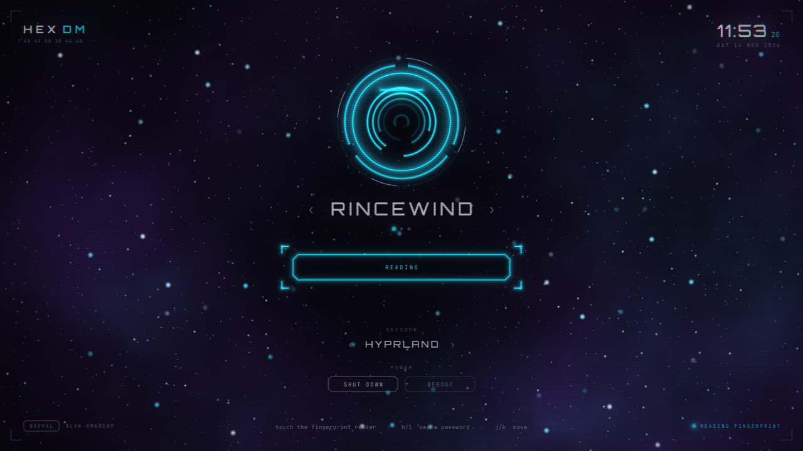
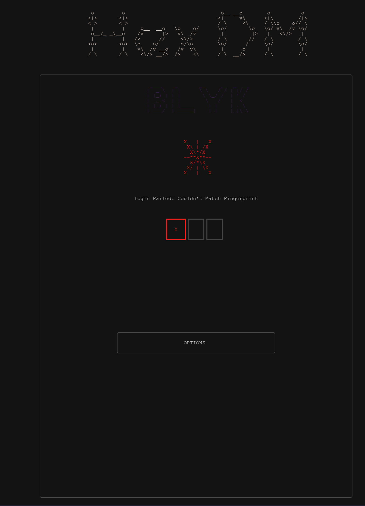
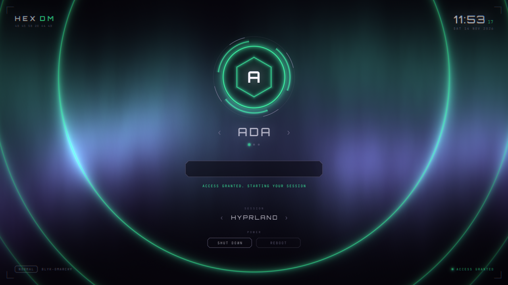

# HexDM

**Phase 2 is now complete (v0.2)! You'll be able to find the newest stable release on the [release branch](github.com/tesinclair/HexDM/tree/release).**


HexDM (Hex Display Manager) is a rendered, keyboard driven display manager built specifically for easy integration with fprintd (the fingerprint daemon for linux).
HexDM is named for the magic powered computer Hex at Unseen University in the Terry Pratchett discworld novels.


HexDM is made with Vim in mind, so any terminal users should find it quite relaxing.

The greeter draws straight to the screen with SDL3 and OpenGL ES. There is no X server or
Wayland compositor underneath it. If the graphics can't start, HexDM falls back to a plain
terminal greeter, so a broken driver never locks you out.





### Installation

**Prerequisites**:

You'll need GO, make, gcc, pkg-config, PAM, SDL3 and the OpenGL ES headers (on Arch: `sdl3` and `mesa`).
The make file should tell you off and direct you on what to get if you need.

**Installation**:

Installation is quite simple:

Navigate to your command line and run:
```
git clone -b release --depth 1 https://github.com/tesinclair/HexDM.git
cd HexDM
sudo make install
cd ..
rm -rf HexDM
```

With any luck, you should see a successful installation.

### Controls

The screen is four rows: user, login, session and power. The keys for the
row you are on are always shown at the bottom of the screen.

| Key | What it does |
| --- | --- |
| `j` / `k` (or up / down) | Move between rows |
| `h` / `l` (or left / right) | Change the row: switch user, switch between fingerprint and password, pick a session, pick shut down or reboot |
| `i` | Type your password (HexDM starts here when there is no fingerprint to wait for) |
| `esc` | Stop typing and go back to moving around |
| `enter` | Log in. On the power row: press twice to confirm |

### Configuration

The look is set in `/etc/hexdm/hexdm.conf`, which `make install` creates (and never overwrites).
Every setting is explained in the file. In short:

```
background = hexgrid     # hexgrid, starfield, horizon, aurora, rain, plain or random
accent     = #22E4FF     # also: base, primary, text, dim, error, success, warning
bloom      = 1           # also: scanlines, vignette. 0 turns one off
clock      = 24h         # or 12h
```

A line HexDM can't read is written to the log and ignored, so a typo can't stop you logging in.

### Trying it out

```
make demo
```

opens the greeter in a window with a pretend system behind it: made-up users, no root, no PAM,
and nothing is ever started. The password `hex` logs in, `crash` shows a session that fails to
start, and the user `rincewind` has a fingerprint enrolled. `q` closes it.

`make demo DEMO_ARGS="-background starfield"` tries another background, and `-tui` shows the
terminal fallback.

### Roadmap

- [x] Phase 1 (v0.1):
    - [x] Functioning Display manager hosting qtile for wayland
    - [x] Integrates Fprind natively without jank
- [x] Phase 2 (v0.2):
    - [x] Window Managing
        - [x] Parse systemwide window managers
        - [x] Run selected window manager
    - [x] UX:
        - [x] Show remaining tries for fprint
        - [x] Show loading fingerprint when being read
        - [x] Show red fingerprint when failed
        - [x] Have error messages dissappear
    - [x] Options:
        - [x] Introduce poweroff option
        - [x] Introduce Reboot option
        - [x] Introduce session selection for multiple WMs
    - [x] State:
        - [x] Remember which user chooses which WM
- [ ] Phase 3 (v0.3):
    - [ ] Nitty Gritty
        - [ ] Define Codebase standards
        - [ ] Sniffing for Fingerprint Scanner Atomic changes
    - [ ] Daemon-Greeter Architecture
        - [ ] Rewrite hexdm/main.go as a daemon
        - [ ] Rewrite TUI as a greeter
    - [x] GUI Greeter
    - [x] Config (greeter look only, so far)
- [ ] Phase 4 (v1.2026.0):
    - [ ] Organization:
        - [ ] Migrate to own organization page
        - [ ] Decide on official licensing
        - [ ] Update docs
    - [ ] Contribution:
        - [ ] Create comprehensive contribution guide (Incl. Rules on AI)
        - [ ] Github issues templates
        - [ ] PR templates
    - [ ] Testing:
        - [ ] Set up Unit tests
        - [ ] Create mocks for hardware integration
    - [ ] CI/CD:
        - [ ] Github actions
    - [ ] Officially Open Contribution
- [ ] Phase 5 (v1.2026.1):
    - [ ] Greeter Customisation API/DSL (TBD).

### Contribution

Right now HexDM is *not* accepting contributions. Version 0.3 (Phase 3)
is going to be a very big change, and it doesn't
make sense to be jumping through hoops in the mean time.

That being said, any bugs or issues can be raised, and I'll get to them
ASAP. 

You're also more than welcome to suggest new features :)
