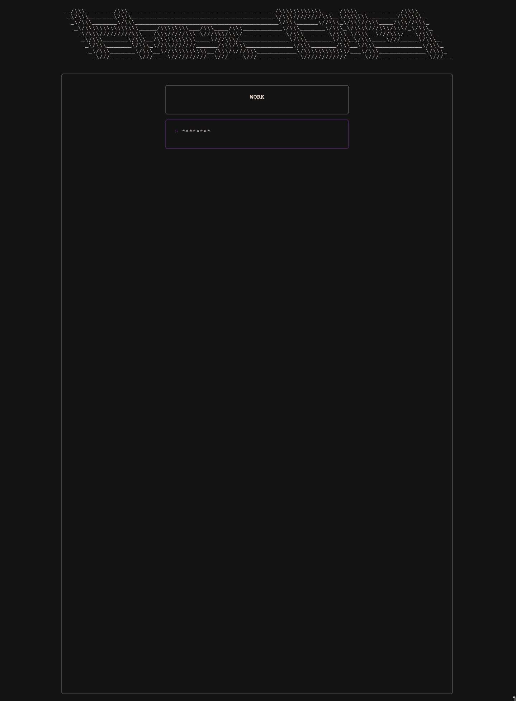
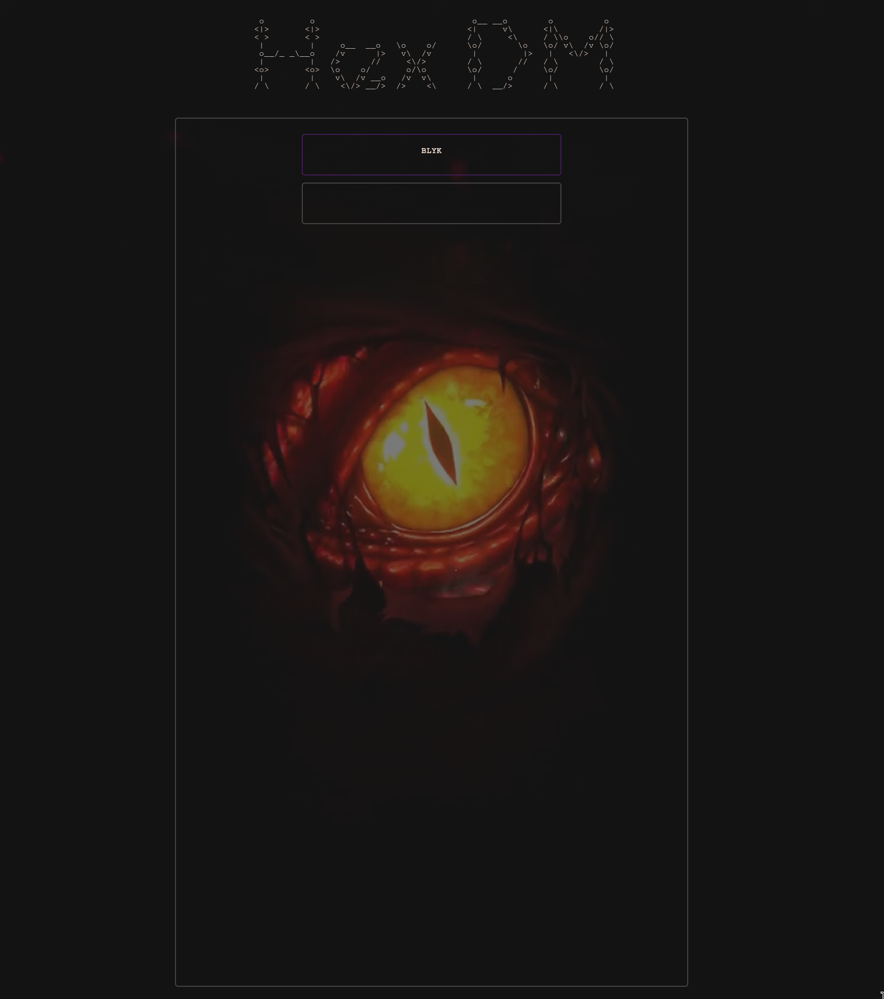

# HexDM
HexDM (Hex Display Manager) is a TUI based display manager build specifically for easy integration with fprintd (the fingerprint daemon for linux).
HexDM is named for the magic powered computer Hex at Unseen University in the Terry Pratchett discworld novels.



HexDM is made with Vim in mind, so any terminal users should find it quite relaxing.

HexDM also doesn't enforce backgrounds, so you can configure a background of your choosing to sit behind it like so:



### Installation
**Prerequesites**: 
- Window manager: qtile
- Window protocol: Wayland
- OS: arch linux

To test the correct environment, run `qtile start -b wayland` from a tty, if this opens a new window manager, you are set up.
You can then run `qtile cmd-obj -o cmd -f shutdown` to kill the session.

**Installation**:
Installation is quite simple:

Navigate to your command line and run:
```
git clone github.com/tesinclair/HexDM
cd HexDM
sudo make install
```

With any luck, you should see a successful installation.


### Controls
As mentioned before HexDM works with vim motions, so

- h: Left (often change user, or authentication method)
- l: Right (Same as above)
- j: Down
- k: Up

Directions with the arrow keys are also supported.

- i: input mode. Use this to start typing a password
- Escape: Normal mode. Use this to navigate
