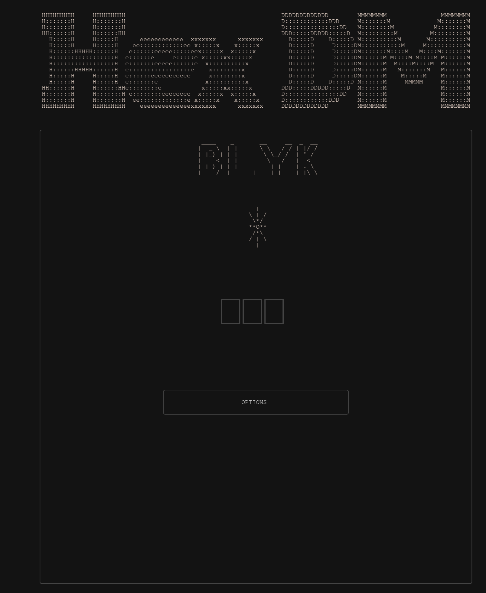
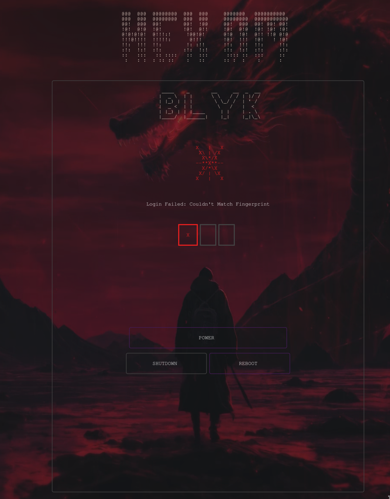

# HexDM

**Phase 2 is now complete (v0.2)! You'll be able to find the newest stable release on the [release branch](github.com/tesinclair/HexDM/tree/release).**


HexDM (Hex Display Manager) is a TUI based display manager build specifically for easy integration with fprintd (the fingerprint daemon for linux).
HexDM is named for the magic powered computer Hex at Unseen University in the Terry Pratchett discworld novels.



HexDM is made with Vim in mind, so any terminal users should find it quite relaxing.

HexDM also doesn't enforce backgrounds, so you can configure a background of your choosing to sit behind it like so:



### Installation

**Prerequisites**:

You'll need GO, make, gcc, and some other standard packages.
The make file should tell you off and direct you on what to get if you need.

**Installation**:

Installation is quite simple:

Navigate to your command line and run:
```
git clone -b release --depth 1 https://github.com/tesinclair/HexDM.git
cd HexDM
sudo make install
cd ..
rm -rf HexDM
```

With any luck, you should see a successful installation.

### Controls

As mentioned before HexDM works with vim motions, you'll be
able to find plenty of instructions on the web.

### Roadmap

- [x] Phase 1 (v0.1):
    - [x] Functioning Display manager hosting qtile for wayland
    - [x] Integrates Fprind natively without jank
- [x] Phase 2 (v0.2):
    - [x] Window Managing
        - [x] Parse systemwide window managers
        - [x] Run selected window manager
    - [x] UX:
        - [x] Show remaining tries for fprint
        - [x] Show loading fingerprint when being read
        - [x] Show red fingerprint when failed
        - [x] Have error messages dissappear
    - [x] Options:
        - [x] Introduce poweroff option
        - [x] Introduce Reboot option
        - [x] Introduce session selection for multiple WMs
    - [x] State:
        - [x] Remember which user chooses which WM
- [ ] Phase 3 (v0.3):
    - [ ] Nitty Gritty
        - [ ] Define Codebase standards
        - [ ] Sniffing for Fingerprint Scanner Atomic changes
    - [ ] Daemon-Greeter Architecture
        - [ ] Rewrite hexdm/main.go as a daemon
        - [ ] Rewrite TUI as a greeter
    - [ ] GUI Greeter
    - [ ] Config
- [ ] Phase 4 (v1.2026.0):
    - [ ] Organization:
        - [ ] Migrate to own organization page
        - [ ] Decide on official licensing
        - [ ] Update docs
    - [ ] Contribution:
        - [ ] Create comprehensive contribution guide (Incl. Rules on AI)
        - [ ] Github issues templates
        - [ ] PR templates
    - [ ] Testing:
        - [ ] Set up Unit tests
        - [ ] Create mocks for hardware integration
    - [ ] CI/CD:
        - [ ] Github actions
    - [ ] Officially Open Contribution
- [ ] Phase 5 (v1.2026.1):
    - [ ] Greeter Customisation API/DSL (TBD).

### Contribution

Right now HexDM is *not* accepting contributions. Version 0.3 (Phase 3)
is going to be a very big change, and it doesn't
make sense to be jumping through hoops in the mean time.

That being said, any bugs or issues can be raised, and I'll get to them
ASAP. 

You're also more than welcome to suggest new features :)
